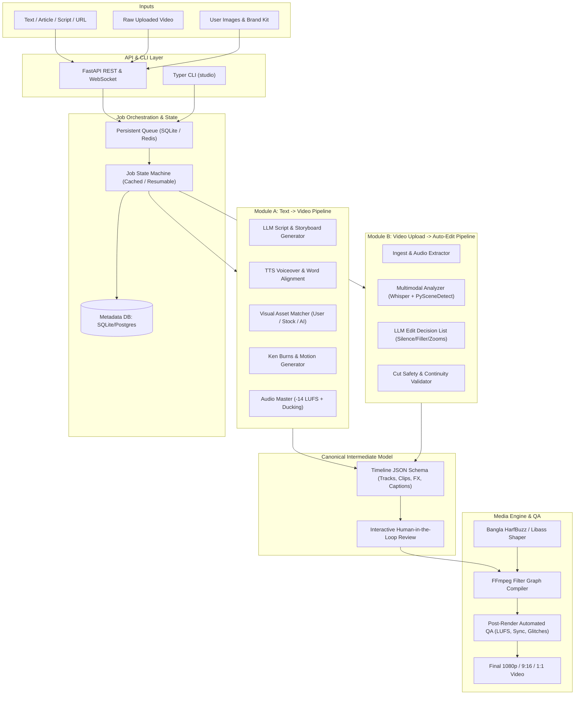

# AI Video Studio Architecture

## 1. System Overview

AI Video Studio is a modular, event-driven personal video creation and auto-editing engine. It combines multimodal LLM orchestration, neural voice synthesis (TTS), automatic speech recognition (ASR), and frame-accurate media composition via FFmpeg.



## 2. Directory Layout and Storage

The studio maintains an explicit directory structure per project:
```
data/
└── projects/
    └── <project_id>/
        ├── project.json          # Project metadata & configuration
        ├── inputs/               # Original uploaded images, videos, audio, text
        ├── cache/                # Stage hashes, intermediate TTS wavs, proxies
        │   ├── tts/
        │   ├── transcripts/
        │   └── thumbnails/
        ├── audio/                # Mastered voiceover, ducked music bed, sfx
        ├── timeline/             # timeline.json (Canonical schema), revisions
        ├── renders/              # Final exported videos (1080p, shorts, proxies)
        └── logs/                 # Structured execution logs and stage metrics
```

## 3. Pipeline Stages

### Module A: Text-to-Video Pipeline
1. **Content Understanding & Scripting**: Generates hooked narration, calibrated to speaking rate (e.g. 130 words/min in Bangla, 150 words/min in English).
2. **Storyboard Breakdown**: Structures scenes with narration, visual intent, visual asset priority, and transition cues.
3. **Voiceover & Word Alignment**: Produces scene audio and word-level timestamps (`start`, `end`, `word`).
4. **Visual Sourcing & Preprocessing**: Matches user images first, falls back to stock/AI; applies smart crop, safe margins, and Ken Burns easing.
5. **Timeline Compilation**: Compiles scenes, audio, and animated subtitles into `Timeline` JSON.
6. **Mastering & Rendering**: Sidechain music ducking under voice, EBU R128 (-14 LUFS) normalization, libass Bengali subtitle burn-in, FFmpeg render.
7. **Automated QA**: Checks duration, audio levels, black frames, and video integrity.

### Module B: Video Upload & Auto-Edit Pipeline
1. **Ingest & Proxy**: Normalizes input video to constant frame rate (CFR) and generates a fast editing proxy.
2. **Multimodal Analysis**:
   - Audio: Whisper transcription, silence detection, filler words (`মানে`, `ইয়ে`, `um`, `uh`), loudness map.
   - Video: Shot boundary detection, keyframes, face saliency tracking.
3. **Edit Decision Engine**: Generates cuts for silences and fillers, punch-in zooms (110%-115%) to smooth jump cuts, B-roll cutaway placement, and 9:16 re-framing.
4. **Rule-Based Cut Validator**: Guarantees no cuts occur mid-word or violate minimum shot durations.
5. **Human Checkpoint**: Presents decisions for user approval before rendering.
6. **Render & Delivery**: Executes smart re-encoding from the original source files.
